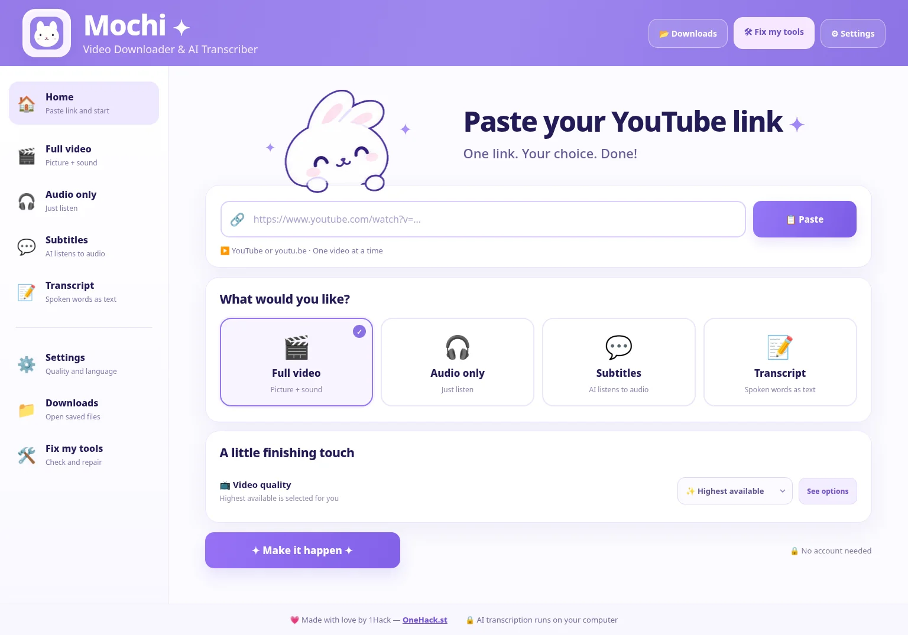

# 🐰 Mochi — Video Downloader & AI Transcriber

**One YouTube link → download the video, save audio, create subtitles, or turn speech into text.**

**[⬇️ Download Mochi.zip](https://github.com/Unknown-1Hacker/mochi-video-downloader-ai-transcriber/releases/latest/download/Mochi.zip)** · Free · Windows, macOS & Linux · Local AI



## ✨ What can Mochi do?

| Choose | Get |
|---|---|
| 🎬 **Full video** | Download video and sound; choose the best available resolution or a lower one |
| 🎧 **Audio only** | Save the video's audio, optionally as MP3 |
| 💬 **Subtitles** | Create timed **SRT + VTT** subtitle files by listening to the audio |
| 📝 **Transcript** | Convert spoken audio to readable **TXT** text |

**Mochi doesn't copy YouTube captions for subtitles or transcripts.** It listens to the original audio using local [faster-whisper](https://github.com/SYSTRAN/faster-whisper). Downloads use [yt-dlp](https://github.com/yt-dlp/yt-dlp).

## 🚀 Start in three steps

1. **[Download Mochi.zip](https://github.com/Unknown-1Hacker/mochi-video-downloader-ai-transcriber/releases/latest/download/Mochi.zip)**, then extract it into a folder.
2. Double-click **`1 INSTALL & OPEN`** for your OS: **Windows**, **Mac**, or **Linux**. The first run installs its own Python environment, downloader, media tools, and transcription engine; internet is needed.
3. Paste a YouTube video link, choose what you want, and press **Make it happen ✦**.

After a successful setup, Mochi tidies its folder. Next time, double-click **`Run Mochi Now`**. Your saved media and AI models remain on your computer, accessible through **📂 Open my saved files** inside the app.

> 💡 A security confirmation may be needed for an app downloaded from GitHub, and on some Linux desktops you may need to choose **Allow Launching**. You don't need to turn off OS security protections.

## 🛠 Something went wrong?

Open Mochi → **Fix my tools** (top-right). Mochi handles known dependency and download problems conservatively, keeps recovery logs locally, and avoids deleting your downloads. Some future platform changes or restricted videos may still require manual intervention.

## 🔒 Privacy & requirements

- **Local AI:** Transcription runs on your own CPU or supported GPU. No cloud speech-to-text API.
- **Internet:** Needed to install dependencies and models, and to download videos.
- **Compatibility:** Modern Windows, macOS, and Linux with a supported 64-bit Python/runtime. Universal compatibility with every OS/device is not guaranteed.
- **Usage:** Download only videos you're permitted to download, respecting site terms and creators' rights.

## 🧪 For contributors

```bash
python -m pip install pytest
python -m pytest -q
```

The app source is in `app/`; the `1 INSTALL & OPEN` launchers are at the repository root. Tests use offline mocks and real FFmpeg audio where possible; they don't prove live YouTube support or flawless transcription.

---

💜 **Made with love by [1Hack](https://onehack.st/)**
