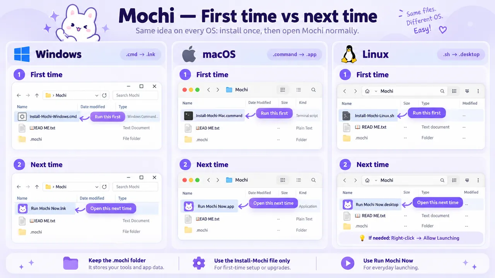

  

<h1 align="center">Mochi</h1>

<strong>Video Downloader &amp; AI Transcriber</strong>

One YouTube link. Your choice. Done. ✨

  <a href="https://github.com/Unknown-1Hacker/mochi-video-downloader-ai-transcriber/releases/latest/download/Mochi.zip"><strong>⬇️ Download Mochi.zip</strong></a>
  &nbsp; · &nbsp;
  <a href="https://github.com/Unknown-1Hacker/mochi-video-downloader-ai-transcriber/releases/latest">View latest release</a>

Free · Windows · macOS · Linux · Local AI · No account

  

### 🎁 What can Mochi do?

| Pick | What you get |
|:--|:--|
| 🎬 **Full video** | Video + audio, at your chosen available quality |
| 🎧 **Audio only** | Original audio or MP3 |
| 💬 **Subtitles** | AI-generated SRT + VTT with timestamps |
| 📝 **Transcript** | Spoken words in a TXT file |

### 🧭 How Mochi works

  <strong>🖱️ Open Mochi</strong> 
  Checks its tools and prepares what's missing  
  ⬇️  
  <strong>🔗 Paste a YouTube link → 🎯 Pick what you want</strong> 
  Best available quality by default, or choose your own  
  ⬇️

| 🎬 Video / 🎧 Audio | 💬 Subtitles / 📝 Transcript |
|:---:|:---:|
| **📥 [yt-dlp](https://github.com/yt-dlp/yt-dlp)** | **📥 yt-dlp → 🧠 [faster-whisper](https://github.com/SYSTRAN/faster-whisper)** |
| Downloads your selected media and quality | Downloads the original audio, then listens to the speech locally—not existing captions |
| **💾 Video or audio file** | **💾 SRT + VTT subtitles or TXT text** |

  <strong>✅ Saved on your computer</strong> 
  ⚡ Smart defaults · ♻️ Reuses completed work · 🛠️ Repairs known issues · 🧹 Keeps things tidy

### 🚀 Three steps. That's it.

1. **[Download Mochi.zip](https://github.com/Unknown-1Hacker/mochi-video-downloader-ai-transcriber/releases/latest/download/Mochi.zip)** and extract it.
2. **Open `Install-Mochi-Windows.cmd`, `Install-Mochi-Mac.command`, or `Install-Mochi-Linux.sh`** for your OS. Mochi prepares its tools.
3. **Paste a YouTube link → pick what you want → Make it happen ✦**

### 🗂 First time vs next time

**Download and extract `Mochi.zip` → open the `Mochi` folder.** On your OS, use **Install-Mochi** once for setup (or again for updates), then **Run Mochi Now** for everyday use.

  

Illustration: folder appearances vary by OS; the `.mochi` folder is created during setup.

💜 Next time, just open **Run Mochi Now**. Your downloads stay on your computer.

> 🐧 On Linux, if the shortcut won't launch, right-click **Run Mochi Now.desktop → Allow Launching**. Or open a terminal in the Mochi folder and run `sh .mochi/run.sh`. Keep the `.mochi` folder when upgrading.

> 💡 First setup needs internet. Your OS might ask you to approve the launcher; keep its security protections enabled. **Linux opens the file as text?** Open a terminal inside the extracted Mochi folder and run `sh ./Install-Mochi-Linux.sh`.

**🛠️ Something stuck?** Open Mochi → **Fix my tools**. It can repair recognized problems without deleting your downloads.

⚙️ Requirements, privacy & developer notes

- **System:** Modern 64-bit Windows, macOS, or Linux. Compatibility with every device isn't guaranteed.
- **Internet:** Needed for setup, AI model downloads, and video downloads; speech recognition runs locally without a cloud transcription API.
- **Permissions:** Download only content you're allowed to save, respecting site terms and creators' rights.
- **Contributing:** Source lives in `app/`. To run tests, install Python dependencies plus `pytest`, `numpy`, `pillow`, and FFmpeg, then run `python -m pytest -q`. Automated checks don't guarantee every video or OS setup will work.

---

💜 Made with love by <a href="https://onehack.st/"><strong>1Hack</strong></a>

