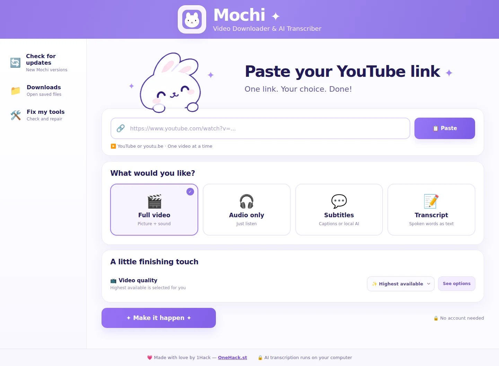
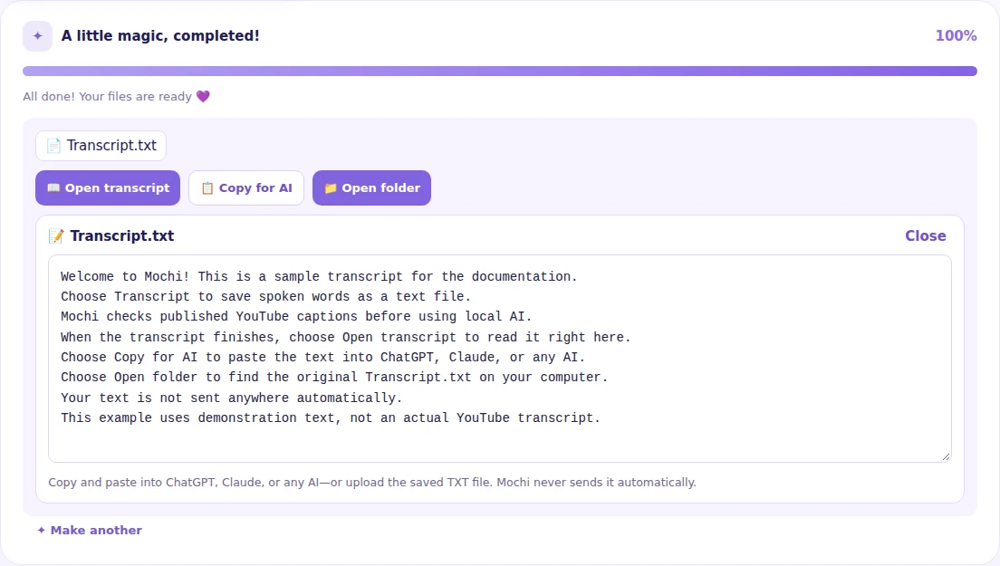
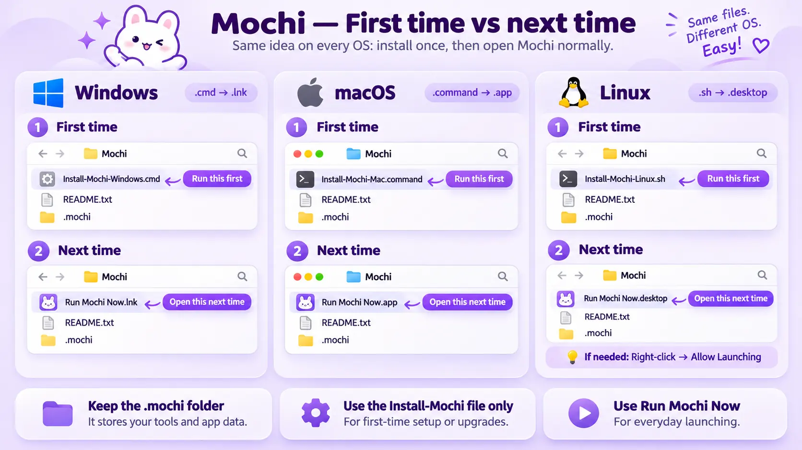

  

<h1 align="center">Mochi</h1>

<strong>Video Downloader &amp; AI Transcriber</strong>

One YouTube link. Your choice. Done. ✨

  <a href="https://github.com/Unknown-1Hacker/mochi-video-downloader-ai-transcriber/releases/latest/download/Mochi.zip"><strong>⬇️ Download Mochi.zip</strong></a>
  &nbsp; · &nbsp;
  <a href="https://github.com/Unknown-1Hacker/mochi-video-downloader-ai-transcriber/releases/latest">View latest release</a>

Free · Windows · macOS · Linux · Local AI · No account

  

Actual Mochi home screen · Video, audio, subtitles and transcript are selected here; the sidebar contains only tools.

---

## 🎁 What can Mochi save?

| Choose | You get |
|:--|:--|
| 🎬 **Video** | Video with sound, in your chosen available quality |
| 🎧 **Audio** | Original audio or MP3 |
| 💬 **Subtitles** | SRT + VTT subtitle files |
| 📝 **Transcript** | Plain TXT text—easy to read, copy into an AI chat, or upload |

---

## 🧭 How Mochi works

**🐰 Run Mochi Now → 🖥️ Local browser studio → 🔗 Paste one YouTube link → 🎯 Pick ONE result**

**🎬 Full video** → `yt-dlp` downloads → `FFmpeg` joins picture + sound when needed → 💾 Video

**🎧 Audio only** → `yt-dlp` downloads → `FFmpeg` converts if you choose MP3 → 💾 Audio / MP3

**💬 Subtitles / 📝 Transcript** → Mochi takes the first working route:

> **⚡ 1 · YouTube captions** — `yt-dlp` checks available caption tracks.  
> ↓ *If missing or unusable*  
> **🔄 2 · Second direct caption reader** — `youtube-transcript-api` tries another way.  
> ↓ *Only if both caption methods fail*  
> **🧠 3 · Local AI** — `yt-dlp` gets the original audio → `faster-whisper` recognizes speech **on your computer**.

**💾 Saved result:** `Subtitles.srt` + `Subtitles.vtt` **or** `Transcript.txt`, depending on your choice. Usable captions skip audio downloading and AI entirely; AI tools and model are installed only if needed.

**📝 Transcript ready?** **Open transcript** to read it in Mochi · **Copy for AI** to paste into any AI chat · **Open folder** to find the original `Transcript.txt`. Mochi never uploads your transcript to an AI chat automatically.

<strong>🛠 Curious? The Mochi scripts behind the magic</strong>

`app/launcher.py` starts the local `app/studio.py` → `app/core.py` handles your choice → `app/captions.py` checks both caption routes → `app/doctor.py` prepares optional speech tools when needed. Saved files live in `.mochi/Downloads/`.

No paid transcription service or account required. Captions and AI-generated text can contain mistakes.

<strong>👀 See the actual finished transcript view</strong>

  

Captured from Mochi's current interface using clearly labeled demonstration text—not an actual YouTube transcript.

---

## 🚀 Get started

1. **[Download Mochi.zip](https://github.com/Unknown-1Hacker/mochi-video-downloader-ai-transcriber/releases/latest/download/Mochi.zip)** and extract it.
2. **Run the Install-Mochi file for your OS** (Windows, macOS, or Linux).
3. **Paste your link → choose a result → Make it happen ✦**

### 🗂 First time vs next time

**First time:** `Install-Mochi` for your OS &nbsp; → &nbsp; **Next time:** `Run Mochi Now`.

  

Folder appearance varies by OS. The hidden `.mochi` folder is created during setup. First setup requires internet.

---

## 💾 Storage & cleanup

**Why is setup bigger than the ZIP?** Mochi downloads its tools on first use. Local AI needs more space **only if existing captions cannot be used**. Size varies by OS.

**⚠️ Keep the `.mochi` folder** — it contains Mochi's tools **and your saved files**.

<strong>📂 What's inside .mochi — and what can I safely remove?</strong>

| Folder inside `Mochi/.mochi/` | Contents | Remove? |
|:--|:--|:--|
| `Downloads/` | **Your saved videos, audio, subtitles and transcripts** | 🛑 **Keep** |
| `cache/` | Temporary installation downloads | ✅ Yes, with Mochi closed; newer setup cleans these |
| `models/` | Downloaded AI speech models | ♻️ Optional; AI may download them again |
| `Downloads/.mochi/audio-cache/` | Reusable audio for transcripts | ♻️ Optional; audio may download again |
| `venv/`, `python/`, `ffmpeg/`, `deno/`, `tools/`, `app/` | Mochi's working programs | 🔒 **Keep** |

**Show hidden folders:** Windows → View → Show → Hidden items · macOS → Cmd + Shift + . · Linux → Ctrl + H

Never delete the whole `.mochi` folder to save space.

---

## 🛠 Need help?

**Something stuck?** Open Mochi → **Fix my tools**, or [ask the 1Hack community](https://onehack.st/t/mochi-free-youtube-downloader-ai-subtitles-transcript/326924).

<strong>🔄 Updating Mochi or reopening an old browser bookmark</strong>

- **Update today:** Finish your current job, download the latest Mochi.zip, extract/merge its files into your **existing Mochi folder** (do not delete `.mochi`), then run the `Install-Mochi` file for your OS again.
- **Reopen Mochi:** Use **Run Mochi Now**. A bookmarked local browser link can stop working after Mochi restarts because the port and session key may change.
- **Coming later, not available yet:** In-app updates, persistent transcript history and stable browser-bookmark reopening. These are tracked in [the roadmap](https://github.com/Unknown-1Hacker/mochi-video-downloader-ai-transcriber/issues/11).

<strong>🐧 Linux: launcher won't open?</strong>

If **Run Mochi Now.desktop** does not open, right-click it → **Allow Launching**. Alternatively, open a terminal in the Mochi folder and run `sh .mochi/run.sh`.

If **Install-Mochi-Linux.sh** opens as text, run `sh ./Install-Mochi-Linux.sh` from a terminal in the extracted Mochi folder.

<strong>⚙️ Requirements, privacy & developer notes</strong>

- **System:** Modern 64-bit Windows, macOS or Linux. Not every device is guaranteed compatible.
- **Internet:** Needed for setup, downloads and first-time AI models. AI speech recognition runs locally, not through a cloud transcription API.
- **Captions:** Mochi tries [yt-dlp](https://github.com/yt-dlp/yt-dlp), then [youtube-transcript-api](https://github.com/jdepoix/youtube-transcript-api). If captions are unavailable, it uses local [faster-whisper](https://github.com/SYSTRAN/faster-whisper). No scraping of third-party transcript websites.
- **Safety:** Keep OS security protections enabled when approving the launcher. Only save videos you have permission to download, respecting applicable terms and creators' rights.
- **Developers:** Source is in `app/`. For tests, install Python dependencies, `pytest`, `numpy`, `pillow` and FFmpeg; run `python -m pytest -q`. Tests do not guarantee every real video or OS setup works.

---

💜 Made with love by <a href="https://onehack.st/"><strong>1Hack</strong></a>

